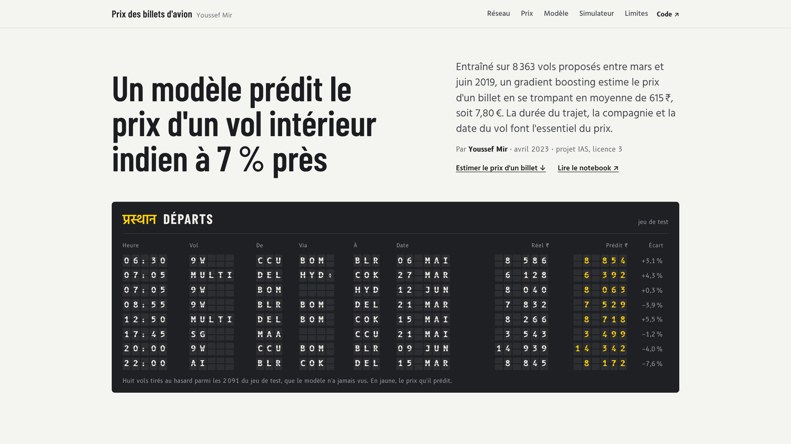
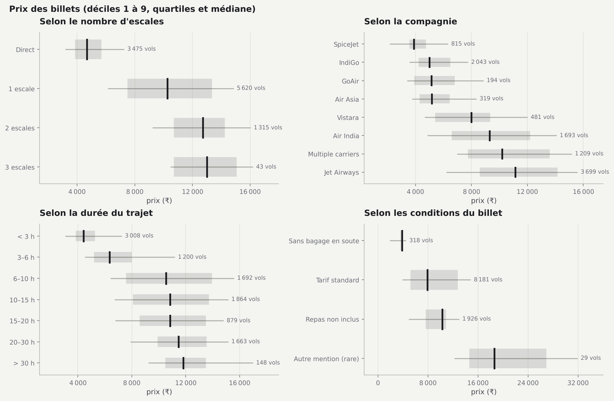
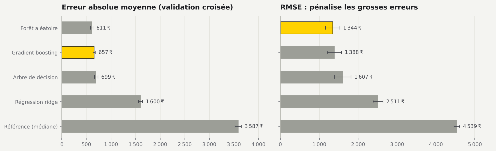
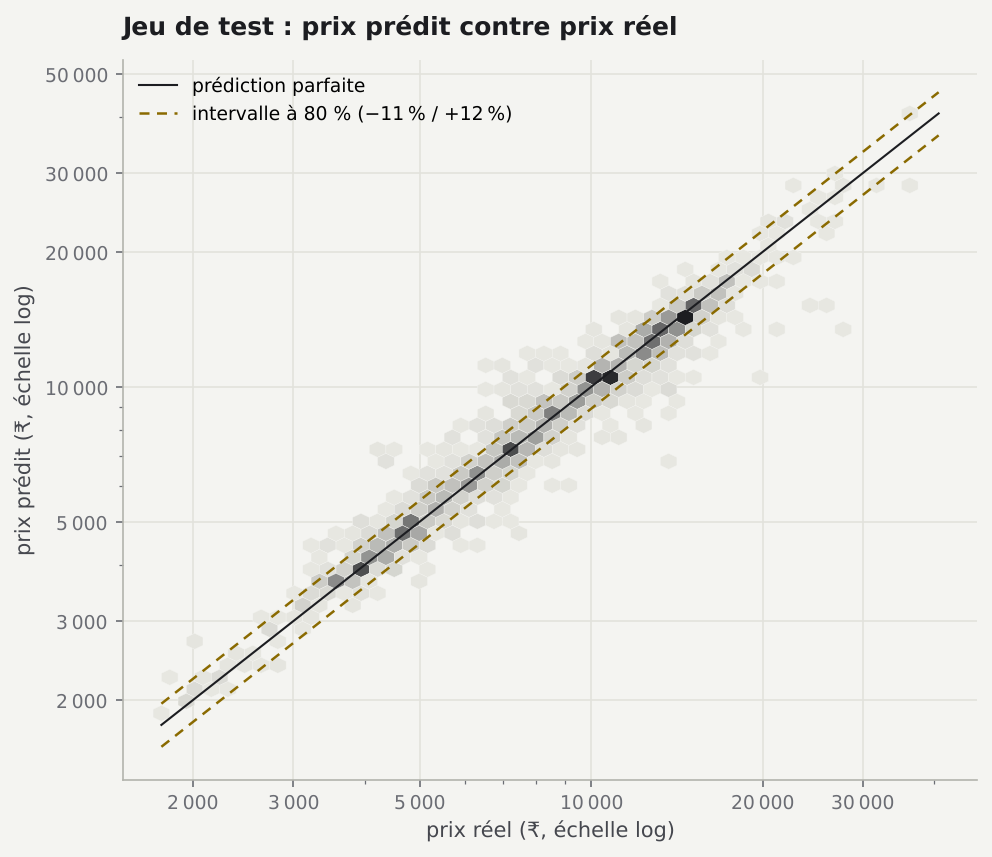

# Prédire le prix des billets d'avion en Inde

Un modèle de gradient boosting prédit le prix d'un vol intérieur indien en se trompant en moyenne de 615 ₹ (environ 7,80 €, soit 6,9 % du prix) sur des vols qu'il n'a jamais vus.

[](https://youssefmir.github.io/Prediction-of-the-price-of-airline-tickets-for-an-Indian-company-/)

**[Voir le site interactif](https://youssefmir.github.io/Prediction-of-the-price-of-airline-tickets-for-an-Indian-company-/)** · [Lire le notebook](https://github.com/youssefmir/Prediction-of-the-price-of-airline-tickets-for-an-Indian-company-/blob/main/notebooks/prediction_prix_billets.ipynb) · [Données](#données)

## En bref

- **615 ₹ d'erreur moyenne** (6,9 % du prix) et un R² de 0,94 sur 2 091 vols de test, mis de côté pendant toute la mise au point.
- **Une escale double le prix** : 4 667 ₹ en médiane pour un vol direct, 10 262 ₹ avec une escale.
- **La compagnie compte autant que l'itinéraire** : de 3 873 ₹ chez SpiceJet à 11 134 ₹ chez Jet Airways, en médiane.
- **Réserver tard coûte cher** : le 1er mars 2019, le prix médian atteint 17 686 ₹, près de quatre fois celui des vols de mi-avril (4 823 ₹).
- **Le modèle tourne dans le navigateur** : ses 400 arbres sont exportés en JavaScript et le simulateur du site reproduit les prédictions Python à moins de 0,001 ₹ près.

Sommaire : [Démarrage rapide](#démarrage-rapide) · [Utilisation](#utilisation) · [Résultats](#résultats) · [Méthode](#méthode) · [Données](#données) · [Limites](#limites)

## Le projet

Projet d'IAS de licence 3 (année 2022-2023), réalisé par Youssef Mir. La question posée : peut-on estimer le prix d'un vol intérieur indien à partir de ce que l'on sait au moment de le chercher, c'est-à-dire la compagnie, l'itinéraire, la date et les horaires ? Les données décrivent 10 683 vols proposés à la vente pour des voyages entre mars et juin 2019.

Le dépôt contient un site interactif (un récit illustré et un simulateur de prix), un notebook commenté qui détaille toute l'analyse, et le package Python `flight_prices`, testé, sur lequel les deux reposent.

## Démarrage rapide

Prérequis : Python 3.10 ou plus récent (testé avec Python 3.11).

```bash
git clone https://github.com/youssefmir/Prediction-of-the-price-of-airline-tickets-for-an-Indian-company-.git
```

```bash
cd Prediction-of-the-price-of-airline-tickets-for-an-Indian-company-
```

```bash
python -m venv .venv
```

```bash
source .venv/bin/activate        # Windows : .venv\Scripts\activate
```

```bash
pip install -r requirements.txt
```

```bash
pip install -e .
```

```bash
jupyter notebook notebooks/prediction_prix_billets.ipynb
```

Le notebook s'exécute en deux minutes environ. Les données sont incluses dans le dépôt : aucune clé ni aucun téléchargement n'est nécessaire.

## Utilisation

Réexécuter tout le notebook sans l'ouvrir :

```bash
jupyter nbconvert --to notebook --execute --inplace notebooks/prediction_prix_billets.ipynb
```

Régénérer les données du site, `docs/data.js` (deux minutes ; l'option `--reuse` repart du dernier résultat en cache) :

```bash
python scripts/build_site_data.py
```

Prévisualiser le site, puis ouvrir http://localhost:8000 :

```bash
python -m http.server -d docs 8000
```

Lancer les tests (le test de parité avec le navigateur demande Node.js, il est ignoré sinon) :

```bash
pip install -r requirements-dev.txt
```

```bash
pytest
```

Prédire le prix d'un vol avec le package :

```python
from flight_prices.predict import Flight, predict_price, train_model

model = train_model()  # réentraîne le modèle retenu, une dizaine de secondes
flight = Flight("IndiGo", "Bangalore", "Delhi", "BLR → DEL", "2019-05-24", "06:05", 165)
print(round(predict_price(model, flight)))  # 4355 (₹)
```

## Résultats



Chaque facteur fait varier le prix du simple au triple. Ces facteurs sont liés entre eux (un vol direct est court, Jet Airways vend surtout des trajets avec escale), d'où le recours à un modèle multivarié.



La forêt aléatoire a la plus faible erreur absolue moyenne, le gradient boosting la plus faible RMSE : il commet moins de grosses erreurs. Il est retenu aussi parce qu'il tient en 35 372 nœuds, contre près de 2 millions pour la forêt, ce qui permet de l'exécuter dans un navigateur.



Sur le jeu de test, la plupart des vols suivent la diagonale. Pour 80 % d'entre eux, le prix réel se situe entre −11 % et +12 % du prix prédit.

## Méthode

1. **Nettoyage** (`data.py`) : suppression d'une ligne incomplète, des 220 doublons exacts et d'une durée impossible ; harmonisation des libellés (« New Delhi » et « Delhi » désignent le même aéroport) ; les 7 billets en classe affaires sont décrits puis exclus du modèle.
2. **Variables** (`features.py`) : 24 variables connues au moment de chercher un vol : compagnie, cabine, villes, conditions du billet, nombre d'escales, aéroports d'escale, durée, heures de départ et d'arrivée, date du vol.
3. **Protocole** (`modeling.py`) : un seul découpage, 80 % des vols pour l'entraînement et 20 % pour le test. Le choix du modèle et de ses réglages se fait par validation croisée à 5 plis (le modèle est entraîné cinq fois, chaque fois évalué sur un cinquième différent des vols) sur l'entraînement seulement ; le test ne sert qu'une fois, à la fin. Les modèles apprennent le logarithme du prix, car les écarts de prix sont multiplicatifs.
4. **Modèles** : une référence qui prédit toujours le prix médian, une régression ridge, un arbre de décision, une forêt aléatoire et un gradient boosting, réglé ensuite par une recherche aléatoire de 12 combinaisons. Les métriques sont la MAE (erreur absolue moyenne), la RMSE (qui pénalise les grosses erreurs), la MAPE (erreur relative moyenne) et le R² (part de la variance des prix expliquée).
5. **Interprétation** : importance des variables par permutation (hausse de l'erreur quand on mélange une variable) et erreurs par compagnie et par tranche de prix.
6. **Site** (`export.py`, `docs/model.js`) : le modèle final est exporté en JSON et réévalué en JavaScript ; un test compare les deux implémentations sur des centaines de vols.

## Données

| Fichier | Contenu | Source | Licence |
|---|---|---|---|
| `data/raw/Data_Train.xlsx` | 10 683 vols intérieurs indiens, voyages du 1er mars au 27 juin 2019, avec leur prix en roupies | Concours MachineHack « Predict The Flight Ticket Price » (2019), copie publique sur [Kaggle](https://www.kaggle.com/datasets/nikhilmittal/flight-fare-prediction-mh) | Non précisée (données de concours) |
| `data/raw/india_outline_simplified.geojson` | Contour de l'Inde simplifié pour la carte du site | [DataMeet](https://github.com/datameet/maps), « India composite », simplifié par `scripts/simplify_outline.py` | CC BY 4.0 |

Le dictionnaire des colonnes et le détail du nettoyage sont dans [data/README.md](data/README.md). Les montants en euros utilisent le taux de référence moyen de la BCE en 2019 : 1 € = 78,84 ₹.

## Structure du dépôt

```text
.
├── data/
│   ├── README.md                    sources, licences et dictionnaire des colonnes
│   └── raw/                         données d'origine et contour de l'Inde
├── notebooks/
│   └── prediction_prix_billets.ipynb    analyse complète, commentée et exécutée
├── src/flight_prices/               package Python
│   ├── data.py, features.py         nettoyage et variables explicatives
│   ├── modeling.py, predict.py      modèles, évaluation, prédiction d'un vol
│   ├── plotting.py, labels.py       figures et libellés du notebook
│   ├── export.py, parity.py         export du modèle vers le navigateur et vérification
│   └── experiment.py, site_data.py, geo.py    données du site
├── scripts/                         génération des données du site et du contour
├── docs/                            site interactif, publié par GitHub Pages
├── assets/                          couverture et figures de ce README
├── tests/                           tests pytest
└── pyproject.toml, requirements.txt, requirements-dev.txt
```

## Limites

- **Une période courte, cinq liaisons.** Les vols vont de mars à juin 2019 ; le modèle ne dit rien d'autres lignes ni d'autres années. Jet Airways a d'ailleurs suspendu ses vols le 17 avril 2019.
- **Pas de date d'achat.** Le délai de réservation n'est connu qu'à travers la date du vol : les prix semblent relevés début mars, ce qui rend chers les vols de début mars.
- **Un bruit irréductible.** 201 combinaisons de variables strictement identiques ont plusieurs prix différents ; ces écarts dépendent d'informations absentes des données.
- **Une fourchette globale.** La fourchette à 80 % du simulateur est la même pour tous les vols ; une régression par quantiles en donnerait une propre à chaque vol.
- **La classe affaires est exclue** (7 billets), et la conversion en euros est indicative.

## Évolutions par rapport à la première version

- La régression linéaire était réentraînée sur le jeu de test avant d'y être évaluée.
- La sélection de variables était apprise sur toutes les données, test compris, ce qui faussait l'évaluation.
- Les hyperparamètres étaient choisis d'après le score obtenu sur le jeu de test ; ils le sont désormais par validation croisée sur l'entraînement.
- Certains graphiques affichaient de mauvaises variables, et l'arbre « réglé » n'utilisait pas les meilleurs paramètres trouvés.
- Les doublons exacts sont retirés ; les billets à plus de 300 € ne sont plus supprimés sans justification.
- Le « pourcentage de bonne prédiction » est remplacé par des métriques standard : MAE, RMSE, MAPE et R².
- Le code est organisé en package testé, le notebook a été réécrit et un site interactif présente les résultats.

## Auteurs et références

- Youssef Mir, projet d'IAS de licence 3, année 2022-2023.
- Données des vols : concours MachineHack « Predict The Flight Ticket Price » (2019).
- Contour de l'Inde : « India boundaries », communauté DataMeet, licence CC BY 4.0.
- Taux de change : Banque centrale européenne, taux de référence moyen 2019 (série EXR.A.INR.EUR.SP00.A).
- Pedregosa F. et al. (2011). *Scikit-learn: Machine Learning in Python*. Journal of Machine Learning Research, 12, 2825-2830.
